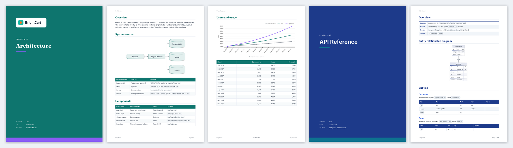

# proj-docs: branded PDF documentation for any codebase

A [Claude Code](https://claude.com/claude-code) skill that reads your repository and writes
**evidence-based project documentation as branded PDFs**: developer guide, architecture, API
reference, runbook, user guide, 1-year forecast, budget and 30 more. The PDFs use your
project's own colours, fonts and logo. When the code changes, only the affected sections and
PDFs are updated.



[](https://github.com/zalhashemi/proj-docs/actions/workflows/ci.yml)


## Install

In Claude Code:

```text
/plugin marketplace add zalhashemi/proj-docs
/plugin install project-docs@proj-docs
```

Or copy `skills/project-docs/` into `~/.claude/skills/` (all projects) or `<repo>/.claude/skills/` (one project).

**Requirements:**
- Python 3.9+.
- One PDF renderer: WeasyPrint (needs Pango) **or** Google Chrome / Chromium.
- Optional: [mermaid-cli](https://github.com/mermaid-js/mermaid-cli) for diagrams.

On first use, the skill checks your setup and asks before installing its Python packages
into `~/.cache/project-docs/venv`. See [skills/project-docs/README.md](skills/project-docs/README.md#dependencies).

## Use

Just ask:

> *"Generate a developer docs pack for this project"*
> *"Write handover docs, we're transferring this to another team"*
> *"Make a 1-year forecast and budget"*
> *"Update the docs"*: after code changes, it patches only what changed

Claude then:
1. **Scans** the repo: stack, scripts, routes, models, env var names, CI, tests and git history.
2. Lets you **pick documents**, by pack (Developer, Business, User, Ops, Handover, Everything) or one by one.
3. **Detects your brand** (Tailwind, CSS variables, MUI/Chakra/Mantine/AntD, Flutter, Android,
   iOS, logo) and fixes low-contrast colours. With no UI, it offers 5 default themes.
4. **Asks** only what the repo can't answer. "Unknown" is a fine answer.
5. **Drafts** each doc from a template, citing file paths. Anything unverified is marked as an assumption.
6. **Renders**, **verifies** (blank pages, overflow, fonts, links, contrast) and **looks at** the pages.

Output stays in your repo: `docs/*.md` (editable), `docs/pdf/*.pdf`, and `docs/.project-docs/` (state).

### Before the project exists
Ask for a **build plan**. The rest of the catalog is offered once the project is complete,
unless you ask for a specific document.

### Documents
| Pack | Documents |
|---|---|
| Developer | dev guide, architecture (with ADRs), API reference, data model (ERD), testing strategy, CI/CD, env & config reference, contributing, integration guide, upgrade/migration guide |
| Business | project brief, PRD, roadmap (Gantt table), 1-year forecast (3 scenarios, charts), budget & resources, risk register |
| User | user guide, quick start (CLI/API variants when there's no UI), admin guide, release notes, troubleshooting & FAQ |
| Ops | runbook, incident response (+ postmortem), monitoring & SLOs, backup & DR, third-party services |
| Handover / governance | handover, stakeholders & RACI, dependency inventory, tech-debt register, security threat model (STRIDE), privacy, compliance checklist (GDPR/SOC 2/HIPAA), support & SLA, competitive analysis, onboarding deck outline |

## Trust rules

- **No invented facts.** Versions, endpoints, people, costs and compliance status come from the
  repo or from you. Everything else is visibly tagged as an `ASSUMPTION` and listed in an appendix.
- **No secrets.** Env vars are listed by name only.
- **Finance maths is computed by a script**, shown as inputs → formulas → outputs, with ranges
  and a "planning estimates, not financial advice" line.
- **Legal-adjacent docs** are checklists marked "not legal advice". They never say "compliant".

## Examples

Rendered samples, generated by the skill from the test fixtures:
- [`samples/brightcart/`](samples/brightcart/docs/pdf/): a React + Tailwind app, theme detected from the code
- [`samples/ledgerline/`](samples/ledgerline/docs/pdf/): a FastAPI service with the corporate-blue theme
- [`samples/theme-previews/themes.pdf`](samples/theme-previews/themes.pdf): all themes side by side
- [`docs/pdf/dev-guide.pdf`](docs/pdf/dev-guide.pdf): the skill documenting itself

The finance figures in the samples come from sample inputs, not real data.

## Contributing

See [CONTRIBUTING.md](CONTRIBUTING.md) and [DEV_GUIDE.md](DEV_GUIDE.md), which explains how the
skill is built. Issues and PRs are welcome.

## License

[MIT](LICENSE). The bundled fonts (Inter, JetBrains Mono, Source Serif 4, Fraunces) are under
the SIL Open Font License; see `skills/project-docs/assets/fonts/licenses/`.
