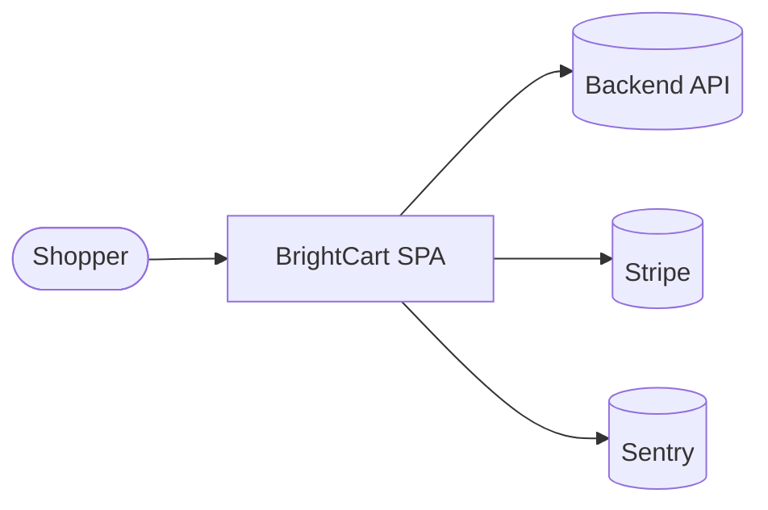
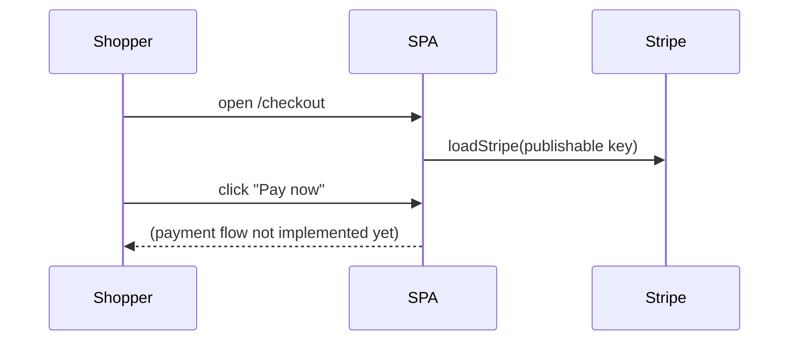

## Overview

BrightCart is a client-side React single-page application. Vite builds it into static files that
Vercel serves. The browser talks directly to three external systems: BrightCart's own backend
API (`VITE_API_URL`), Stripe for payments and Sentry for error reporting. There is no server
code in this repository.

## System context

| External system | Used for | Evidence |
|---|---|---|
| Backend API | Product data (planned) | `VITE_API_URL` read in `src/pages/Home.tsx` |
| Stripe | Payments | `loadStripe` in `src/pages/Checkout.tsx` |
| Sentry | Error reporting | `Sentry.init` in `src/main.tsx` |
| Vercel | Hosting and deploys | `vercel.json`, `deploy` job in `.github/workflows/ci.yml` |

## Components

| Component | Responsibility | Tech | Location |
|---|---|---|---|
| App shell | Router and page layout | React Router 6 | `src/App.tsx` |
| Home page | Product listing | React, Tailwind | `src/pages/Home.tsx` |
| Checkout page | Starts payment | Stripe.js | `src/pages/Checkout.tsx` |
| ProductCard | Product tile | React | `src/components/ProductCard.tsx` |
| Bootstrap | Mounts React, starts Sentry | React DOM | `src/main.tsx` |

## Data flow: checkout

1. React Router renders `Checkout` for `/checkout` (`src/App.tsx`).
2. Importing the page calls `loadStripe` with `VITE_STRIPE_PUBLISHABLE_KEY`.
3. The **Pay now** button has no handler yet, so no payment is created ⟨assumption⟩ that this is work in progress.

## Deployment view

GitHub Actions runs `lint` and `test` on every push and pull request. On `main` it also runs
`npx vercel deploy --prod` with the `VERCEL_TOKEN` secret. `vercel.json` rewrites every path
to `/`, so client-side routes survive a page refresh.

## Cross-cutting concerns

| Concern | Approach | Evidence |
|---|---|---|
| Configuration | Build-time `VITE_*` env vars | `.env.example` |
| Error handling | Sentry browser SDK | `src/main.tsx` |
| Styling | Tailwind with brand tokens | `tailwind.config.js` |
| Authentication | None in the frontend | no auth code found |

## Decision log

### ADR-001: Single-page app on Vite

- **Status:** Accepted
- **Context:** The storefront needs fast navigation and no server rendering ⟨assumption⟩.
- **Decision:** React 18 + Vite, routed client-side (`package.json`, `src/App.tsx`).
- **Consequences:** Static hosting is enough. SEO for product pages is limited without pre-rendering.

### ADR-002: Tailwind CSS for styling

- **Status:** Accepted
- **Context:** One consistent brand palette across components.
- **Decision:** Tailwind 3 with brand colours and fonts in `tailwind.config.js`.
- **Consequences:** No separate CSS files per component; styles live in class names.

### ADR-003: Vercel hosting

- **Status:** Accepted
- **Context:** Static SPA with preview needs ⟨assumption⟩.
- **Decision:** Deploy with the Vercel CLI from CI (`.github/workflows/ci.yml`).
- **Consequences:** Deploys depend on the `VERCEL_TOKEN` secret and Vercel availability.

## Related documents

[Developer Guide](dev-guide.md) · [User Guide](user-guide.md) · [CI/CD and Deployment](cicd-deployment.md)

## Assumptions and open questions

| # | Item | Type | Why unverified | Who can confirm |
|---|------|------|----------------|-----------------|
| A1 | Pay now is unfinished work, not a bug | assumption | button has no handler | frontend lead |
| A2 | Reasons behind ADR-001 and ADR-003 | assumption | inferred from code, no ADR files | tech lead |
| Q1 | What API does `VITE_API_URL` point to, and who owns it? | open question | backend not in repo | engineering lead |
