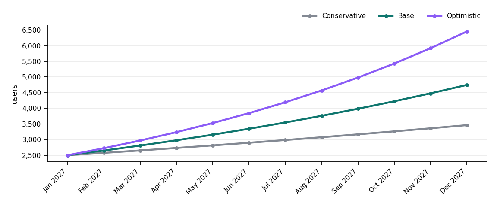
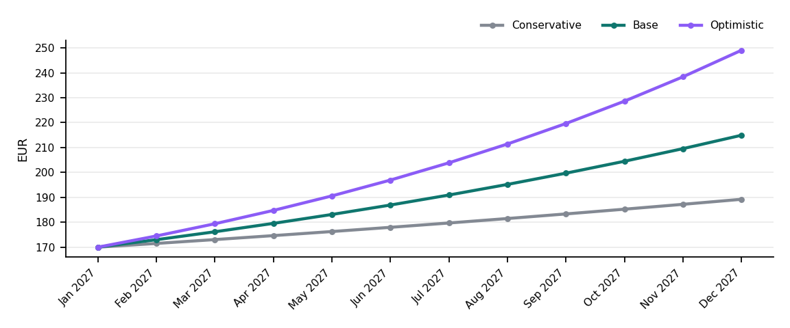
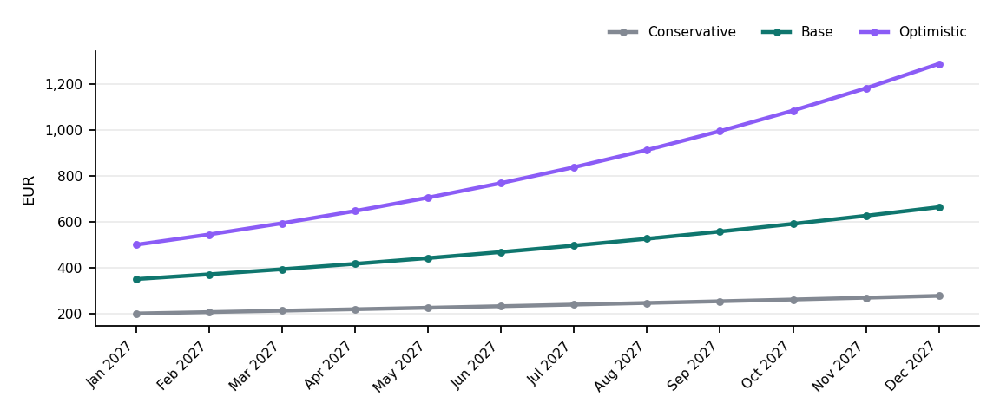
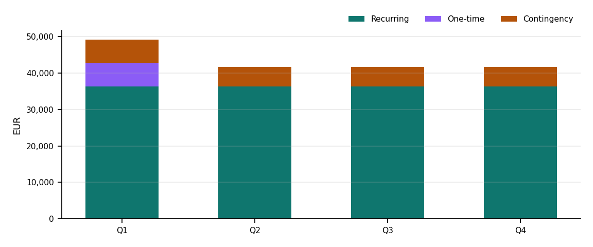

# 1-Year Forecast {#ch-forecast-1yr}

*Planning estimates only, not financial advice.*

> [!NOTE]
> These figures use **sample inputs** supplied to demonstrate the skill. They are not real BrightCart data.

This forecast covers active shoppers, Vercel/hosting cost and usage-based revenue for 2027. Hosting is Vercel (`vercel.json`, deploy job in `.github/workflows/ci.yml`); the only paid runtime services visible in the code are Sentry (`src/main.tsx`) and Stripe (`src/pages/Checkout.tsx`).


## Assumptions

Currency: **EUR**. Period: **monthly, Jan 2027 – Dec 2027**.

| Input | Value | Source | Assumption |
|---|---|---|---|
| `currency` | EUR | user | — |
| `forecast_start` | 2027-01 | user | — |
| `starting_users` | 2500 | user | — |
| `monthly_growth_pct` | 3-9 | user | — |
| `infra_cost_per_user` | 0.02 | user | — |
| `fixed_infra_cost` | 120 | user | — |
| `revenue_model` | usage-based | user | — |
| `arpu` | 4 | user | — |
| `paid_conversion_pct` | 2-5 | user | — |

## Method

```text
users[m]   = starting_users × (1 + growth)^m          (m = 0..11)
infra[m]   = fixed_infra_cost + users[m] × infra_cost_per_user
paying[m]  = users[m] × paid_conversion
revenue[m] = paying[m] × arpu
net        = Σ revenue − Σ infra
```

## Scenarios

| Scenario | Growth / month | Conversion |
|---|---|---|
| Conservative | 3% | 2% |
| Base | 6% | 3.5% |
| Optimistic | 9% | 5% |

## Users and usage



| Month | Conservative | Base | Optimistic |
|---|---:|---:|---:|
| Jan 2027 | 2,500 | 2,500 | 2,500 |
| Feb 2027 | 2,575 | 2,650 | 2,725 |
| Mar 2027 | 2,652 | 2,809 | 2,970 |
| Apr 2027 | 2,732 | 2,978 | 3,238 |
| May 2027 | 2,814 | 3,156 | 3,529 |
| Jun 2027 | 2,898 | 3,346 | 3,847 |
| Jul 2027 | 2,985 | 3,546 | 4,193 |
| Aug 2027 | 3,075 | 3,759 | 4,570 |
| Sep 2027 | 3,167 | 3,985 | 4,981 |
| Oct 2027 | 3,262 | 4,224 | 5,430 |
| Nov 2027 | 3,360 | 4,477 | 5,918 |
| Dec 2027 | 3,461 | 4,746 | 6,451 |

## Infrastructure cost



| Month | Conservative | Base | Optimistic |
|---|---:|---:|---:|
| Jan 2027 | EUR 170 | EUR 170 | EUR 170 |
| Feb 2027 | EUR 172 | EUR 173 | EUR 174 |
| Mar 2027 | EUR 173 | EUR 176 | EUR 179 |
| Apr 2027 | EUR 175 | EUR 180 | EUR 185 |
| May 2027 | EUR 176 | EUR 183 | EUR 191 |
| Jun 2027 | EUR 178 | EUR 187 | EUR 197 |
| Jul 2027 | EUR 180 | EUR 191 | EUR 204 |
| Aug 2027 | EUR 181 | EUR 195 | EUR 211 |
| Sep 2027 | EUR 183 | EUR 200 | EUR 220 |
| Oct 2027 | EUR 185 | EUR 204 | EUR 229 |
| Nov 2027 | EUR 187 | EUR 210 | EUR 238 |
| Dec 2027 | EUR 189 | EUR 215 | EUR 249 |

## Revenue



| Month | Conservative | Base | Optimistic |
|---|---:|---:|---:|
| Jan 2027 | EUR 200 | EUR 350 | EUR 500 |
| Feb 2027 | EUR 206 | EUR 371 | EUR 545 |
| Mar 2027 | EUR 212 | EUR 393 | EUR 594 |
| Apr 2027 | EUR 219 | EUR 417 | EUR 648 |
| May 2027 | EUR 225 | EUR 442 | EUR 706 |
| Jun 2027 | EUR 232 | EUR 468 | EUR 769 |
| Jul 2027 | EUR 239 | EUR 496 | EUR 839 |
| Aug 2027 | EUR 246 | EUR 526 | EUR 914 |
| Sep 2027 | EUR 253 | EUR 558 | EUR 996 |
| Oct 2027 | EUR 261 | EUR 591 | EUR 1,086 |
| Nov 2027 | EUR 269 | EUR 627 | EUR 1,184 |
| Dec 2027 | EUR 277 | EUR 664 | EUR 1,290 |

## Summary

| Metric (year 1) | Conservative | Base | Optimistic | Range |
|---|---:|---:|---:|---|
| Active users at month 12 | 3,461 | 4,746 | 6,451 | 3,461 – 6,451 |
| Total infra cost | EUR 2,150 | EUR 2,283 | EUR 2,447 | EUR 2,150 – EUR 2,447 |
| Total revenue | EUR 2,838 | EUR 5,904 | EUR 10,070 | EUR 2,838 – EUR 10,070 |
| Net (revenue − infra) | EUR 689 | EUR 3,621 | EUR 7,623 | EUR 689 – EUR 7,623 |

## What would change this forecast

- Each extra percentage point of monthly growth adds about **516** users by month 12 (base scenario).
- Infrastructure cost scales linearly with users; a cheaper tier or caching lowers `infra_cost_per_user`.

# Budget and Resource Plan {#ch-budget-resources}

*Planning estimates only, not financial advice.*

> [!NOTE]
> These figures use **sample inputs** supplied to demonstrate the skill. They are not real BrightCart data.

The plan covers the people and tools needed to run the BrightCart storefront in 2027. Tooling lines match services found in the repo: Vercel (`vercel.json`), Sentry (`@sentry/react`) and GitHub Actions (`.github/workflows/ci.yml`).


## Inputs

Currency: **EUR**. Period: **12 months from 2027-01**, contingency **15%**.

| Input | Value | Source | Assumption |
|---|---|---|---|
| `currency` | EUR | user | — |
| `budget_start` | 2027-01 | user | — |
| `contingency_pct` | 15 | user | — |
| `team_roles` | 3 item(s) | user | — |
| `tooling_costs` | 3 item(s) | user | — |
| `fixed_infra_cost` | 120 | user | — |
| `one_time_costs` | 2 item(s) | user | — |

## Team

| Role | Allocation | Monthly rate | Monthly cost | Annual cost |
|---|---:|---:|---:|---:|
| Frontend developer | 100% | EUR 7,500 | EUR 7,500 | EUR 90,000 |
| Product designer | 40% | EUR 6,500 | EUR 2,600 | EUR 31,200 |
| Product manager | 20% | EUR 9,000 | EUR 1,800 | EUR 21,600 |

## Infrastructure and tooling

| Item | Monthly | Annual |
|---|---:|---:|
| Vercel Pro | EUR 20 | EUR 240 |
| Sentry Team | EUR 26 | EUR 312 |
| GitHub Team | EUR 16 | EUR 192 |
| Infrastructure (fixed) | EUR 120 | EUR 1,440 |

## Licences and one-time costs

| Item | Amount | Quarter |
|---|---:|---|
| Accessibility audit | EUR 4,000 | Q1 |
| Product photography | EUR 2,500 | Q1 ⟨assumption⟩ |

## Totals by quarter



| Quarter | Recurring | One-time | Contingency | Total |
|---|---:|---:|---:|---:|
| Q1 (Jan 2027 – Mar 2027) | EUR 36,246 | EUR 6,500 | EUR 6,412 | EUR 49,158 |
| Q2 (Apr 2027 – Jun 2027) | EUR 36,246 | EUR 0 | EUR 5,437 | EUR 41,683 |
| Q3 (Jul 2027 – Sep 2027) | EUR 36,246 | EUR 0 | EUR 5,437 | EUR 41,683 |
| Q4 (Oct 2027 – Dec 2027) | EUR 36,246 | EUR 0 | EUR 5,437 | EUR 41,683 |
| **Year** | **EUR 144,984** | **EUR 6,500** | **EUR 22,723** | **EUR 174,207** |

## Formulas

```text
team_monthly[r]   = allocation[r] × monthly_rate[r]
recurring_monthly = Σ team_monthly + Σ tooling + fixed_infra
recurring[q]      = 3 × recurring_monthly
contingency[q]    = (recurring[q] + one_time[q]) × contingency_pct
total[q]          = recurring[q] + one_time[q] + contingency[q]
```

One-time costs without a month are placed in Q1 ⟨assumption⟩.

# Assumptions and open questions {#ch-assumptions}

Not included: Project Brief, Product Requirements Document, Roadmap, Risk Register, Competitive Analysis (not selected for this sample).

| # | Chapter | Item | Type | Why unverified | Who can confirm |
|---|---|---|---|---|---|
| A1 | 1-Year Forecast | All forecast inputs are sample values | assumption | demonstration run | product owner |
| A2 | 1-Year Forecast | Stripe fees are not modelled as infra cost | assumption | no pricing data in repo | finance |
| Q1 | 1-Year Forecast | What does "active user" mean: shopper or maker? | open question | not defined in code | product owner |
| A3 | Budget and Resource Plan | All rates and costs are sample values | assumption | demonstration run | finance |
| A4 | Budget and Resource Plan | Product photography lands in Q1 | assumption | no month given | product owner |
| Q2 | Budget and Resource Plan | Is the backend API (`VITE_API_URL`) budgeted elsewhere? | open question | backend not in this repo | engineering lead |
