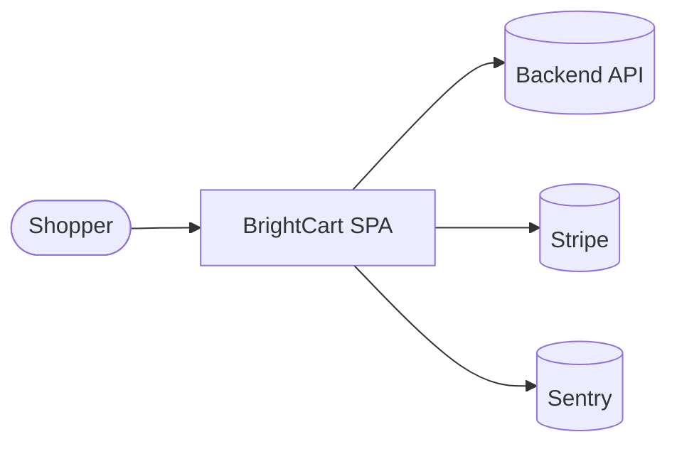
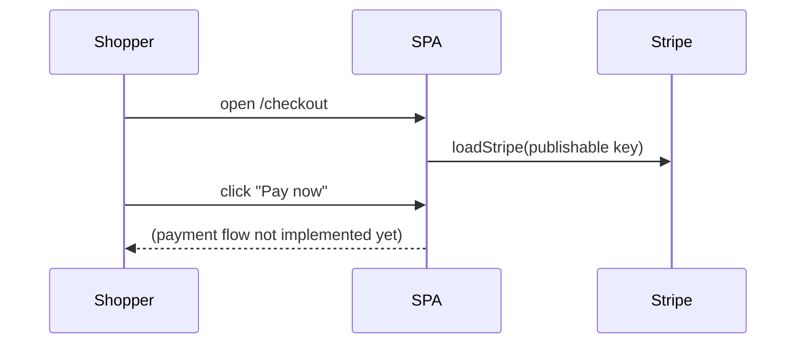

# Developer Guide {#ch-dev-guide}

BrightCart is a React 18 single-page storefront built with Vite and styled with Tailwind CSS
(`package.json`). This guide takes you from a fresh clone to a running dev server.

> [!NOTE]
> Dependencies were not installed in the environment that generated this guide, so the npm
> commands below were read from `package.json` but not executed. They are marked ⟨untested⟩.

## Prerequisites

| Tool | Version | Source |
|---|---|---|
| Node.js | 20 | `.nvmrc`, `node-version: 20` in `.github/workflows/ci.yml` |
| npm | bundled with Node 20 | CI runs `npm ci` |
| Git | any recent | — |

## Clone to running

1. Clone the repository and enter it. The remote URL is not recorded in the repo ⟨assumption⟩.

   ```bash
   git clone <repository-url> brightcart
   cd brightcart
   ```

2. Create your environment file and fill in the values:

   ```bash
   cp .env.example .env
   ```

   | Variable | Needed for |
   |---|---|
   | `VITE_API_URL` | Backend base URL used by `src/pages/Home.tsx` |
   | `VITE_SENTRY_DSN` | Error reporting (`src/main.tsx`); empty disables it |
   | `VITE_STRIPE_PUBLISHABLE_KEY` | Checkout (`src/pages/Checkout.tsx`) |

3. Install dependencies ⟨untested⟩:

   ```bash
   npm install
   ```

4. Start the dev server ⟨untested⟩:

   ```bash
   npm run dev
   ```

   Vite serves the app on `http://localhost:5173` by default ⟨assumption⟩. No port is set in the repo.

## Project structure

```text
brightcart/
├── index.html            # Vite entry; loads Poppins + Playfair Display
├── tailwind.config.js    # brand colours and font families
├── vercel.json           # SPA rewrite: every path serves /
├── public/               # logo.svg, favicon.svg
├── src/
│   ├── main.tsx          # React root + Sentry.init
│   ├── App.tsx           # routes: / and /checkout
│   ├── index.css         # Tailwind layers + CSS variables
│   ├── pages/            # Home.tsx, Checkout.tsx
│   ├── components/       # ProductCard.tsx
│   └── App.test.tsx      # Vitest + Testing Library
└── .github/workflows/ci.yml
```

## Common workflows

| Command | What it does | Tested |
|---|---|---|
| `npm run dev` | Start the Vite dev server | ⟨untested⟩ |
| `npm run build` | Type-check (`tsc -b`) and build to `dist/` | ⟨untested⟩ |
| `npm run preview` | Serve the production build locally | ⟨untested⟩ |
| `npm run lint` | ESLint over the repo | ⟨untested⟩ |
| `npm test` | Run Vitest once (`vitest run`) | ⟨untested⟩ |

### Add a page

1. Create `src/pages/<Name>.tsx`, following `src/pages/Home.tsx`.
2. Register a route in `src/App.tsx`:

   ```tsx
   <Route path="/orders" element={<Orders />} />
   ```

3. Production needs no server change: `vercel.json` already rewrites every path to `/`.

### Use the brand styles

Use the Tailwind tokens from `tailwind.config.js` rather than raw hex values:
`bg-brand`, `text-brand-700`, `font-display` (Playfair Display) and `font-sans` (Poppins).

## Testing

```bash
npm test
```

`src/App.test.tsx` has 2 tests: the home page renders, and a placeholder for the checkout
route. See [Testing Strategy](testing-strategy.md).

## Debugging tips

- Vite only exposes variables prefixed with `VITE_` to the browser. A missing value reads as
  `undefined` rather than throwing, so check `.env` first when a feature silently fails.
- Sentry starts in `src/main.tsx` with `VITE_SENTRY_DSN`. Leave it empty locally to avoid
  sending development errors.
- `loadStripe` in `src/pages/Checkout.tsx` runs at module load. An invalid publishable key
  shows up in the browser console as soon as the checkout page is imported.

# Architecture {#ch-architecture}

## Overview

BrightCart is a client-side React single-page application. Vite builds it into static files that
Vercel serves. The browser talks directly to three external systems: BrightCart's own backend
API (`VITE_API_URL`), Stripe for payments and Sentry for error reporting. There is no server
code in this repository.

## System context



| External system | Used for | Evidence |
|---|---|---|
| Backend API | Product data (planned) | `VITE_API_URL` read in `src/pages/Home.tsx` |
| Stripe | Payments | `loadStripe` in `src/pages/Checkout.tsx` |
| Sentry | Error reporting | `Sentry.init` in `src/main.tsx` |
| Vercel | Hosting and deploys | `vercel.json`, `deploy` job in `.github/workflows/ci.yml` |

## Components

| Component | Responsibility | Tech | Location |
|---|---|---|---|
| App shell | Router and page layout | React Router 6 | `src/App.tsx` |
| Home page | Product listing | React, Tailwind | `src/pages/Home.tsx` |
| Checkout page | Starts payment | Stripe.js | `src/pages/Checkout.tsx` |
| ProductCard | Product tile | React | `src/components/ProductCard.tsx` |
| Bootstrap | Mounts React, starts Sentry | React DOM | `src/main.tsx` |

## Data flow: checkout



1. React Router renders `Checkout` for `/checkout` (`src/App.tsx`).
2. Importing the page calls `loadStripe` with `VITE_STRIPE_PUBLISHABLE_KEY`.
3. The **Pay now** button has no handler yet, so no payment is created ⟨assumption⟩ that this is work in progress.

## Deployment view

GitHub Actions runs `lint` and `test` on every push and pull request. On `main` it also runs
`npx vercel deploy --prod` with the `VERCEL_TOKEN` secret. `vercel.json` rewrites every path
to `/`, so client-side routes survive a page refresh.

## Cross-cutting concerns

| Concern | Approach | Evidence |
|---|---|---|
| Configuration | Build-time `VITE_*` env vars | `.env.example` |
| Error handling | Sentry browser SDK | `src/main.tsx` |
| Styling | Tailwind with brand tokens | `tailwind.config.js` |
| Authentication | None in the frontend | no auth code found |

## Decision log

### ADR-001: Single-page app on Vite

- **Status:** Accepted
- **Context:** The storefront needs fast navigation and no server rendering ⟨assumption⟩.
- **Decision:** React 18 + Vite, routed client-side (`package.json`, `src/App.tsx`).
- **Consequences:** Static hosting is enough. SEO for product pages is limited without pre-rendering.

### ADR-002: Tailwind CSS for styling

- **Status:** Accepted
- **Context:** One consistent brand palette across components.
- **Decision:** Tailwind 3 with brand colours and fonts in `tailwind.config.js`.
- **Consequences:** No separate CSS files per component; styles live in class names.

### ADR-003: Vercel hosting

- **Status:** Accepted
- **Context:** Static SPA with preview needs ⟨assumption⟩.
- **Decision:** Deploy with the Vercel CLI from CI (`.github/workflows/ci.yml`).
- **Consequences:** Deploys depend on the `VERCEL_TOKEN` secret and Vercel availability.

# Assumptions and open questions {#ch-assumptions}

Not included: API Reference, Data Model, Contributing Guide, Testing Strategy, CI/CD and Deployment, Environment and Configuration Reference, Security Threat Model, Dependency Inventory, Tech Debt Register, Integration Guide (not selected for this sample).

| # | Chapter | Item | Type | Why unverified | Who can confirm |
|---|---|---|---|---|---|
| A1 | Developer Guide | Repository URL | assumption | no git remote in the repo | maintainer |
| A2 | Developer Guide | Dev server port 5173 | assumption | Vite default, not configured | frontend lead |
| A3 | Developer Guide | npm commands work as listed | assumption | dependencies not installed during generation | frontend lead |
| Q1 | Developer Guide | Where does the backend behind `VITE_API_URL` live? | open question | not in this repo | engineering lead |
| A4 | Architecture | Pay now is unfinished work, not a bug | assumption | button has no handler | frontend lead |
| A5 | Architecture | Reasons behind ADR-001 and ADR-003 | assumption | inferred from code, no ADR files | tech lead |
| Q2 | Architecture | What API does `VITE_API_URL` point to, and who owns it? | open question | backend not in repo | engineering lead |
