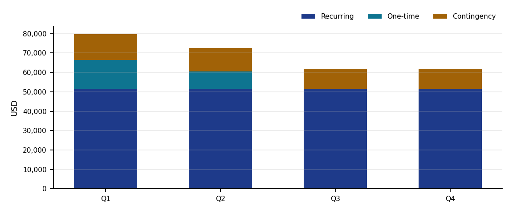

*Planning estimates only, not financial advice.*

> [!NOTE]
> These figures use **sample inputs** supplied to demonstrate the skill. They are not real Ledgerline data.

The plan covers running and hardening the Ledgerline API in 2027. Tooling matches what the repo uses: Sentry (`sentry-sdk`, `app/main.py`) and GitLab CI (`.gitlab-ci.yml`).


## Inputs

Currency: **USD**. Period: **12 months from 2027-01**, contingency **20%**.

| Input | Value | Source | Assumption |
|---|---|---|---|
| `currency` | USD | user | — |
| `budget_start` | 2027-01 | user | — |
| `contingency_pct` | 20 | user | — |
| `team_roles` | 3 item(s) | user | — |
| `tooling_costs` | 2 item(s) | user | — |
| `fixed_infra_cost` | 450 | user | — |
| `one_time_costs` | 2 item(s) | user | — |

## Team

| Role | Allocation | Monthly rate | Monthly cost | Annual cost |
|---|---:|---:|---:|---:|
| Backend developer | 100% | USD 11,000 | USD 11,000 | USD 132,000 |
| DevOps engineer | 30% | USD 12,000 | USD 3,600 | USD 43,200 |
| QA engineer | 25% | USD 8,000 | USD 2,000 | USD 24,000 |

## Infrastructure and tooling

| Item | Monthly | Annual |
|---|---:|---:|
| Sentry Team | USD 26 | USD 312 |
| GitLab Premium (3 seats) | USD 87 | USD 1,044 |
| Infrastructure (fixed) | USD 450 | USD 5,400 |

## Licences and one-time costs

| Item | Amount | Quarter |
|---|---:|---|
| Penetration test | USD 9,000 | Q2 |
| SOC 2 readiness assessment | USD 15,000 | Q1 ⟨assumption⟩ |

## Totals by quarter



| Quarter | Recurring | One-time | Contingency | Total |
|---|---:|---:|---:|---:|
| Q1 (Jan 2027 – Mar 2027) | USD 51,489 | USD 15,000 | USD 13,298 | USD 79,787 |
| Q2 (Apr 2027 – Jun 2027) | USD 51,489 | USD 9,000 | USD 12,098 | USD 72,587 |
| Q3 (Jul 2027 – Sep 2027) | USD 51,489 | USD 0 | USD 10,298 | USD 61,787 |
| Q4 (Oct 2027 – Dec 2027) | USD 51,489 | USD 0 | USD 10,298 | USD 61,787 |
| **Year** | **USD 205,956** | **USD 24,000** | **USD 45,991** | **USD 275,947** |

## Formulas

```text
team_monthly[r]   = allocation[r] × monthly_rate[r]
recurring_monthly = Σ team_monthly + Σ tooling + fixed_infra
recurring[q]      = 3 × recurring_monthly
contingency[q]    = (recurring[q] + one_time[q]) × contingency_pct
total[q]          = recurring[q] + one_time[q] + contingency[q]
```

One-time costs without a month are placed in Q1 ⟨assumption⟩.


## Related documents

[1-Year Forecast](forecast-1yr.md) · [Runbook](runbook.md)

## Assumptions and open questions

| # | Item | Type | Why unverified | Who can confirm |
|---|------|------|----------------|-----------------|
| A1 | All rates and costs are sample values | assumption | demonstration run | finance |
| A2 | SOC 2 readiness lands in Q1 | assumption | no month given | compliance owner |
| Q1 | Who runs `scripts/deploy.sh`? It is referenced in CI but missing | open question | file not in repo | DevOps |
