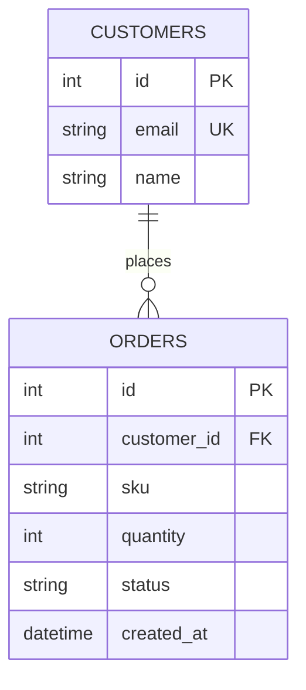

## Overview

| | |
|---|---|
| Database | PostgreSQL 16 (`postgres:16` in `docker-compose.yml`) |
| Access | SQLAlchemy 2.0 ORM, typed `Mapped[...]` models |
| Source | `app/models.py` (models), `alembic/versions/` (migrations) |
| Entities | 2: `Customer`, `Order` |

## Entity relationship diagram



## Entities

### Customer

A wholesale buyer (`app/models.py`, table `customers`).

| Field | Type | Null | Key | Notes |
|---|---|---|---|---|
| `id` | int | no | PK | |
| `email` | varchar(255) | no | unique | |
| `name` | text | no | | |

### Order

An order line for one SKU (`app/models.py`, table `orders`).

| Field | Type | Null | Key | Notes |
|---|---|---|---|---|
| `id` | int | no | PK | |
| `customer_id` | int | no | FK → `customers.id` | indexed |
| `sku` | varchar(64) | no | | |
| `quantity` | int | no | | |
| `status` | text | no | | default `pending` |
| `created_at` | timestamp | no | | default `datetime.utcnow` |

## Relationships

| From | To | Cardinality | On delete | Evidence |
|---|---|---|---|---|
| Customer | Order | 1:N | database default ⟨assumption⟩ | `relationship(back_populates=...)` in `app/models.py` |

## Indexes and constraints

| Table | Index / constraint | Columns | Type |
|---|---|---|---|
| `customers` | primary key | `id` | btree |
| `customers` | unique | `email` | btree |
| `orders` | primary key | `id` | btree |
| `orders` | index | `customer_id` | btree |
| `orders` | foreign key | `customer_id` → `customers.id` | constraint |

## Migrations

- Tool: Alembic · Location: `alembic/versions/` · Count: 2
- `0001_init.py`: create customers and orders
- `0002_order_status.py`: add order status

```bash
make migrate     # alembic upgrade head
```

> [!NOTE]
> `created_at` uses `datetime.utcnow`, which returns naive timestamps. Store and compare times
> as UTC throughout.

## Related documents

[API Reference](api-reference.md) · [Architecture](architecture.md)

## Assumptions and open questions

| # | Item | Type | Why unverified | Who can confirm |
|---|------|------|----------------|-----------------|
| A1 | On-delete behaviour for orders | assumption | no `ondelete=` set in the model | backend lead |
| Q1 | Should `status` be an enum? | open question | free text today | backend lead |
