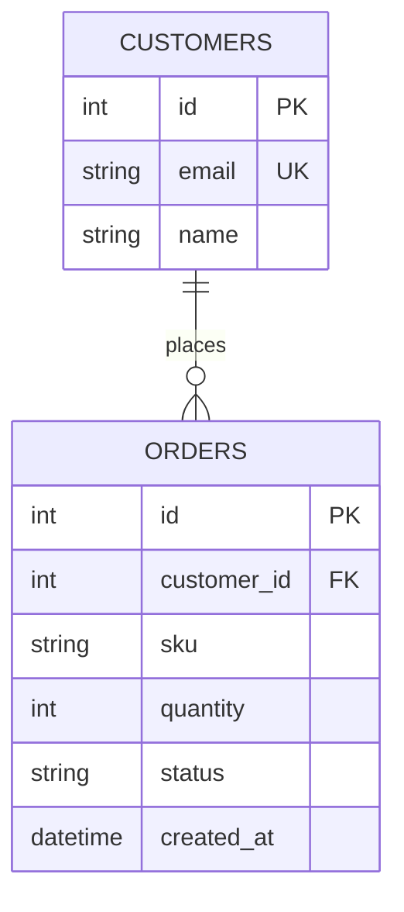

# API Reference {#ch-api-reference}

## Overview

| | |
|---|---|
| Base URL | `http://localhost:8000` (`Dockerfile`, `docker-compose.yml`) |
| Format | JSON |
| Source | Route detection in `app/main.py` and `app/routers/orders.py` (medium confidence), confirmed by reading the code |
| Version | 0.9.2 (`FastAPI(version=...)` in `app/main.py`) |

FastAPI also serves the generated OpenAPI schema at `/openapi.json` and interactive docs at
`/docs` ⟨untested⟩.

## Authentication

Every `/orders` endpoint requires an API key in the `x-api-key` header
(`dependencies=[Depends(require_api_key)]` in `app/routers/orders.py`). The key is compared
with the `API_KEY` environment variable (`app/auth.py`).

```http
x-api-key: <your API key>
```

| Situation | Response |
|---|---|
| Header missing | `422` validation error (header is required) |
| Wrong key | `401` `{"detail": "invalid API key"}` |
| `API_KEY` not set on the server | `500`: `os.environ["API_KEY"]` raises `KeyError` |

## Endpoints

| Method | Path | Summary | Auth |
|---|---|---|---|
| `GET` | `/health` | Liveness check | no |
| `GET` | `/orders` | List orders | yes |
| `POST` | `/orders` | Create an order | yes |
| `GET` | `/orders/{order_id}` | Get one order | yes |
| `DELETE` | `/orders/{order_id}` | Cancel an order | yes |

### `GET /health`

Returns service status (`app/main.py`).

```bash
curl http://localhost:8000/health
```

**Response** `200`

```json
{"status": "ok"}
```

### `GET /orders`

Lists orders (`list_orders`, `app/routers/orders.py`).

| Name | In | Type | Required | Description |
|---|---|---|---|---|
| `limit` | query | int | no | Maximum results, default `50` |

```bash
curl "http://localhost:8000/orders?limit=10" -H "x-api-key: $API_KEY"
```

**Response** `200`: an array of `OrderOut`. The current implementation always returns `[]`.

### `POST /orders`

Creates an order from an `OrderIn` body (`app/schemas.py`).

```bash
curl -X POST http://localhost:8000/orders \
  -H "x-api-key: $API_KEY" -H "Content-Type: application/json" \
  -d '{"customer_id": 42, "sku": "MUG-001", "quantity": 12}'
```

> [!WARNING]
> Not implemented yet: the handler raises `501 {"detail": "not implemented"}`. The declared
> success status is `201`.

### `GET /orders/{order_id}`

| Name | In | Type | Required | Description |
|---|---|---|---|---|
| `order_id` | path | int | yes | Order ID |

The current handler always returns `404 {"detail": "order not found"}`.

### `DELETE /orders/{order_id}`

Cancels an order. Returns `204 No Content`.

```bash
curl -X DELETE http://localhost:8000/orders/42 -H "x-api-key: $API_KEY"
```

## Schemas

**OrderIn**

| Field | Type | Required |
|---|---|---|
| `customer_id` | int | yes |
| `sku` | string | yes |
| `quantity` | int | yes |

**OrderOut**: every `OrderIn` field, plus:

| Field | Type | Notes |
|---|---|---|
| `id` | int | Order ID |
| `status` | string | `pending` by default in the database (`app/models.py`) |

## Error codes

| Status | Detail | When |
|---|---|---|
| 401 | `invalid API key` | `x-api-key` doesn't match `API_KEY` |
| 404 | `order not found` | `GET /orders/{order_id}` |
| 422 | validation error | missing header, or a body or path value of the wrong type |
| 501 | `not implemented` | `POST /orders` |

# Data Model {#ch-data-model}

## Overview

| | |
|---|---|
| Database | PostgreSQL 16 (`postgres:16` in `docker-compose.yml`) |
| Access | SQLAlchemy 2.0 ORM, typed `Mapped[...]` models |
| Source | `app/models.py` (models), `alembic/versions/` (migrations) |
| Entities | 2: `Customer`, `Order` |

## Entity relationship diagram



## Entities

### Customer

A wholesale buyer (`app/models.py`, table `customers`).

| Field | Type | Null | Key | Notes |
|---|---|---|---|---|
| `id` | int | no | PK | |
| `email` | varchar(255) | no | unique | |
| `name` | text | no | | |

### Order

An order line for one SKU (`app/models.py`, table `orders`).

| Field | Type | Null | Key | Notes |
|---|---|---|---|---|
| `id` | int | no | PK | |
| `customer_id` | int | no | FK → `customers.id` | indexed |
| `sku` | varchar(64) | no | | |
| `quantity` | int | no | | |
| `status` | text | no | | default `pending` |
| `created_at` | timestamp | no | | default `datetime.utcnow` |

## Relationships

| From | To | Cardinality | On delete | Evidence |
|---|---|---|---|---|
| Customer | Order | 1:N | database default ⟨assumption⟩ | `relationship(back_populates=...)` in `app/models.py` |

## Indexes and constraints

| Table | Index / constraint | Columns | Type |
|---|---|---|---|
| `customers` | primary key | `id` | btree |
| `customers` | unique | `email` | btree |
| `orders` | primary key | `id` | btree |
| `orders` | index | `customer_id` | btree |
| `orders` | foreign key | `customer_id` → `customers.id` | constraint |

## Migrations

- Tool: Alembic · Location: `alembic/versions/` · Count: 2
- `0001_init.py`: create customers and orders
- `0002_order_status.py`: add order status

```bash
make migrate     # alembic upgrade head
```

> [!NOTE]
> `created_at` uses `datetime.utcnow`, which returns naive timestamps. Store and compare times
> as UTC throughout.

# Assumptions and open questions {#ch-assumptions}

Not included: Developer Guide, Architecture, Contributing Guide, Testing Strategy, CI/CD and Deployment, Environment and Configuration Reference, Security Threat Model, Dependency Inventory, Tech Debt Register, Integration Guide (not selected for this sample).

| # | Chapter | Item | Type | Why unverified | Who can confirm |
|---|---|---|---|---|---|
| A1 | API Reference | `/docs` and `/openapi.json` are reachable | assumption | FastAPI default, not run | backend lead |
| Q1 | API Reference | When will `POST /orders` and `GET /orders/{order_id}` be implemented? | open question | handlers are stubs | backend lead |
| Q2 | API Reference | Should a missing `API_KEY` fail at startup instead of per request? | open question | design choice | backend lead |
| A2 | Data Model | On-delete behaviour for orders | assumption | no `ondelete=` set in the model | backend lead |
| Q3 | Data Model | Should `status` be an enum? | open question | free text today | backend lead |
