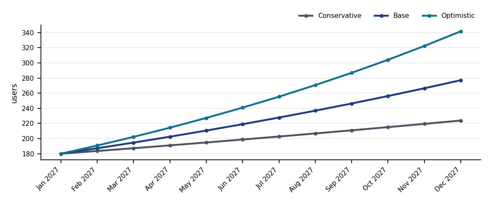
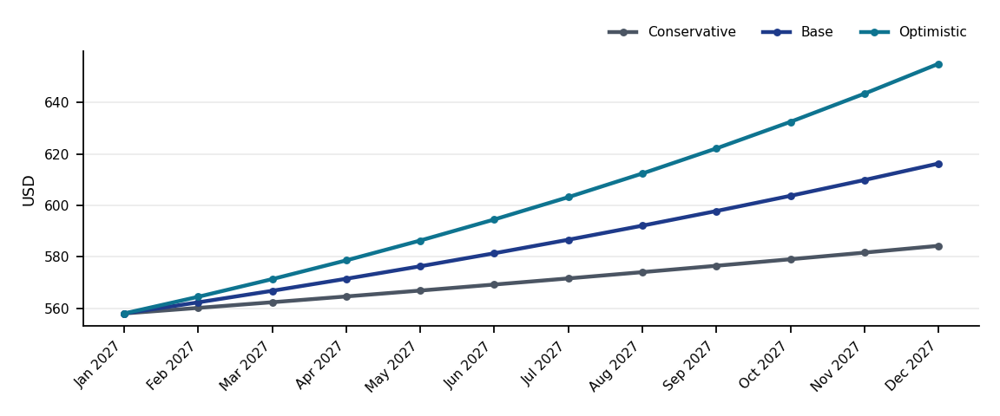
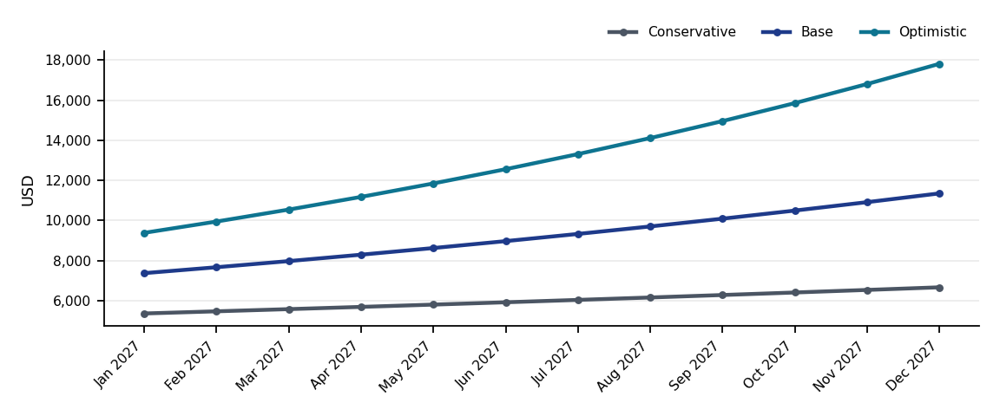

*Planning estimates only, not financial advice.*

> [!NOTE]
> These figures use **sample inputs** supplied to demonstrate the skill. They are not real Ledgerline data.

Users here are **wholesaler accounts** calling the API. Infrastructure is the API container plus PostgreSQL 16 (`docker-compose.yml`) and S3 storage for invoices (`AWS_S3_BUCKET` in `.env.example`). The hosting provider is not in the repo.


## Assumptions

Currency: **USD**. Period: **monthly, Jan 2027 – Dec 2027**.

| Input | Value | Source | Assumption |
|---|---|---|---|
| `currency` | USD | user | — |
| `forecast_start` | 2027-01 | user | — |
| `starting_users` | 180 | user | — |
| `monthly_growth_pct` | 2-6 | user | — |
| `infra_cost_per_user` | 0.6 | user | — |
| `fixed_infra_cost` | 450 | user | — |
| `revenue_model` | subscription | user | — |
| `arpu` | 149 | user | — |
| `paid_conversion_pct` | 20-35 | user | — |

## Method

```text
users[m]   = starting_users × (1 + growth)^m          (m = 0..11)
infra[m]   = fixed_infra_cost + users[m] × infra_cost_per_user
paying[m]  = users[m] × paid_conversion
revenue[m] = paying[m] × arpu
net        = Σ revenue − Σ infra
```

## Scenarios

| Scenario | Growth / month | Conversion |
|---|---|---|
| Conservative | 2% | 20% |
| Base | 4% | 27.5% |
| Optimistic | 6% | 35% |

## Users and usage



| Month | Conservative | Base | Optimistic |
|---|---:|---:|---:|
| Jan 2027 | 180 | 180 | 180 |
| Feb 2027 | 184 | 187 | 191 |
| Mar 2027 | 187 | 195 | 202 |
| Apr 2027 | 191 | 202 | 214 |
| May 2027 | 195 | 211 | 227 |
| Jun 2027 | 199 | 219 | 241 |
| Jul 2027 | 203 | 228 | 255 |
| Aug 2027 | 207 | 237 | 271 |
| Sep 2027 | 211 | 246 | 287 |
| Oct 2027 | 215 | 256 | 304 |
| Nov 2027 | 219 | 266 | 322 |
| Dec 2027 | 224 | 277 | 342 |

## Infrastructure cost



| Month | Conservative | Base | Optimistic |
|---|---:|---:|---:|
| Jan 2027 | USD 558 | USD 558 | USD 558 |
| Feb 2027 | USD 560 | USD 562 | USD 564 |
| Mar 2027 | USD 562 | USD 567 | USD 571 |
| Apr 2027 | USD 565 | USD 571 | USD 579 |
| May 2027 | USD 567 | USD 576 | USD 586 |
| Jun 2027 | USD 569 | USD 581 | USD 595 |
| Jul 2027 | USD 572 | USD 587 | USD 603 |
| Aug 2027 | USD 574 | USD 592 | USD 612 |
| Sep 2027 | USD 577 | USD 598 | USD 622 |
| Oct 2027 | USD 579 | USD 604 | USD 632 |
| Nov 2027 | USD 582 | USD 610 | USD 643 |
| Dec 2027 | USD 584 | USD 616 | USD 655 |

## Revenue



| Month | Conservative | Base | Optimistic |
|---|---:|---:|---:|
| Jan 2027 | USD 5,364 | USD 7,376 | USD 9,387 |
| Feb 2027 | USD 5,471 | USD 7,671 | USD 9,950 |
| Mar 2027 | USD 5,581 | USD 7,977 | USD 10,547 |
| Apr 2027 | USD 5,692 | USD 8,296 | USD 11,180 |
| May 2027 | USD 5,806 | USD 8,628 | USD 11,851 |
| Jun 2027 | USD 5,922 | USD 8,973 | USD 12,562 |
| Jul 2027 | USD 6,041 | USD 9,332 | USD 13,316 |
| Aug 2027 | USD 6,162 | USD 9,706 | USD 14,115 |
| Sep 2027 | USD 6,285 | USD 10,094 | USD 14,961 |
| Oct 2027 | USD 6,410 | USD 10,498 | USD 15,859 |
| Nov 2027 | USD 6,539 | USD 10,918 | USD 16,811 |
| Dec 2027 | USD 6,669 | USD 11,354 | USD 17,819 |

## Summary

| Metric (year 1) | Conservative | Base | Optimistic | Range |
|---|---:|---:|---:|---|
| Active users at month 12 | 224 | 277 | 342 | 224 – 342 |
| Total infra cost | USD 6,849 | USD 7,023 | USD 7,222 | USD 6,849 – USD 7,222 |
| Total revenue | USD 71,942 | USD 110,823 | USD 158,358 | USD 71,942 – USD 158,358 |
| Net (revenue − infra) | USD 65,094 | USD 103,800 | USD 151,136 | USD 65,094 – USD 151,136 |

## What would change this forecast

- Each extra percentage point of monthly growth adds about **31** users by month 12 (base scenario).
- Infrastructure cost scales linearly with users; a cheaper tier or caching lowers `infra_cost_per_user`.


## Related documents

[Budget and Resource Plan](budget-resources.md) · [API Reference](api-reference.md)

## Assumptions and open questions

| # | Item | Type | Why unverified | Who can confirm |
|---|------|------|----------------|-----------------|
| A1 | All forecast inputs are sample values | assumption | demonstration run | product owner |
| A2 | Hosting provider and its pricing | assumption | not in repo (`hosting: unknown`) | DevOps |
| Q1 | Is conversion measured per account or per seat? | open question | no billing code in repo | finance |
