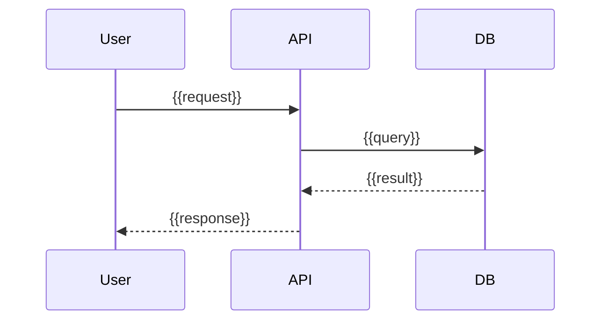

<!-- guide: Describe the system as built. Every component and arrow must correspond to
something in the repo (a package, service in docker-compose, import, client SDK, DB URL env var).
Diagrams in Mermaid. Keep diagrams to ≤12 nodes each; split if larger. -->

## Overview

{{2–4 sentences: what the system is, its main parts, and its style (monolith, services, serverless, mobile + API)}}

## System context

<!-- guide: The system as one box, plus users and external systems (third_party from scan). -->

```mermaid
flowchart LR
  user([{{User}}]) --> app[{{project_name}}]
  app --> ext[({{External service}})]
```

## Components

<!-- guide: One row per deployable unit or major module (packages for monorepos). -->

| Component | Responsibility | Tech | Location |
|---|---|---|---|
| {{component}} | {{responsibility}} | {{framework}} | `{{path}}` |

```mermaid
flowchart TB
  web[{{Frontend}}] --> api[{{API}}]
  api --> db[({{Database}})]
```

## Data flow

<!-- guide: Walk through 1–2 key requests end to end (e.g. "user places an order"), as a
sequence diagram plus numbered steps citing files. -->



1. {{step}} (`{{file}}`)

## Deployment view

<!-- guide: From Dockerfile, compose, k8s, Terraform, platform config. If none, say so. -->

{{deployment description}}

## Cross-cutting concerns

| Concern | Approach | Evidence |
|---|---|---|
| Authentication | {{approach}} | `{{path}}` |
| Logging | {{approach}} | `{{path}}` |
| Error handling | {{approach}} | `{{path}}` |
| Configuration | {{approach}} | `{{path}}` |

## Decision log

<!-- guide: ADR style. Import existing ADRs from docs/adr or docs/decisions if present.
Otherwise infer 3–6 decisions visible in the code (framework choice, DB, auth method, monorepo).
For inferred ones, the "Context" is your reading of the evidence, so mark it ⟨assumption⟩. -->

### ADR-001: {{decision title}}

- **Status:** Accepted
- **Context:** {{why a decision was needed}}
- **Decision:** {{what was chosen}} (`{{evidence}}`)
- **Consequences:** {{trade-offs}}

## Related documents

[Data Model](data-model.md) · [API Reference](api-reference.md) · [CI/CD and Deployment](cicd-deployment.md)

## Assumptions and open questions

| # | Item | Type | Why unverified | Who can confirm |
|---|------|------|----------------|-----------------|
| A1 | {{item}} | assumption | {{reason}} | {{role}} |
