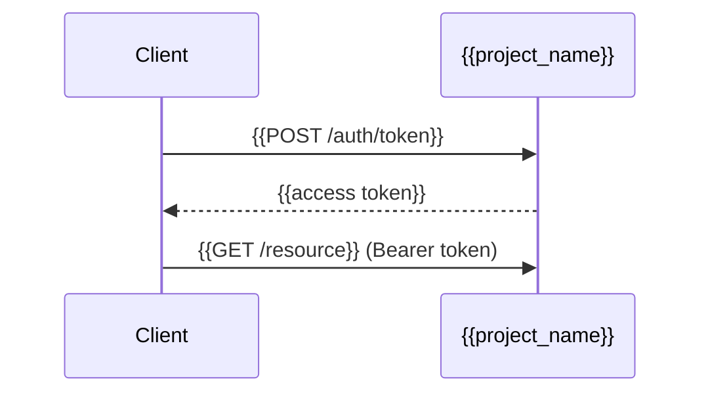

<!-- guide: For external developers building against this system. The API reference lists
endpoints; this guide shows how to combine them into real tasks. Only describe webhooks, rate
limits and SDKs that exist in code or that the user stated. -->

## Before you start

- Base URL: `{{api_base_url}}`
- You need: {{API key / OAuth client / account}}
- Format: {{JSON over HTTPS}}

## Authentication flow

<!-- guide: Step by step from getting credentials to an authenticated call, with a sequence diagram if multi-step (OAuth). -->



```bash
{{curl example}}
```

## Common integration tasks

<!-- guide: 2–4 end-to-end recipes, e.g. "Create an order and poll its status". -->

### {{Task}}

1. {{step with request}}

## Webhooks

<!-- guide: From webhook routes/senders in code. Payload shape, signature verification, retries. "None found" if none. -->

| Event | Payload | Signature | Retries |
|---|---|---|---|
| {{event}} | {{shape}} | {{header/HMAC}} | {{policy}} |

## Rate limits

{{rate_limits from inputs or rate-limit middleware config, else "Not configured in the repo"}}

## Errors and retries

<!-- guide: Which errors are retryable, backoff advice, idempotency keys if supported. -->

| Status | Retry? | Advice |
|---|---|---|
| 429 | Yes | {{backoff}} |

## SDKs and client snippets

```{{language}}
{{snippet}}
```

## Versioning and deprecation

{{versioning scheme from routes (/v1) or headers; deprecation policy ⟨assumption⟩}}

## Related documents

[API Reference](api-reference.md)

## Assumptions and open questions

| # | Item | Type | Why unverified | Who can confirm |
|---|------|------|----------------|-----------------|
| A1 | {{item}} | assumption | {{reason}} | {{role}} |
