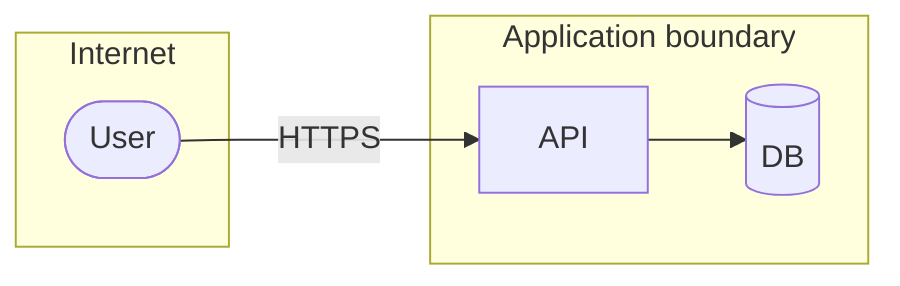

<!-- guide: Describe classes of threat and mitigations, never working exploits. Mitigations
marked "in place" must cite code/config; otherwise they are "recommended". Never print secrets. -->

## Scope

{{system boundary, components in scope, out of scope}}

## Assets

| Asset | Sensitivity | Where it lives | Evidence |
|---|---|---|---|
| {{e.g. user credentials}} | High | {{DB table / service}} | `{{path}}` |

## Trust boundaries

| Boundary | Crossing | Controls |
|---|---|---|
| {{internet → API}} | {{HTTP requests}} | {{auth, validation}} |

## STRIDE analysis

<!-- guide: One or more rows per category, tied to a real component. Status: in place (cite) / partial / recommended. -->

| Category | Threat | Component | Mitigation | Status |
|---|---|---|---|---|
| Spoofing | {{threat}} | {{component}} | {{mitigation}} | {{status}} |
| Tampering | | | | |
| Repudiation | | | | |
| Information disclosure | | | | |
| Denial of service | | | | |
| Elevation of privilege | | | | |

## Findings from the repo

<!-- guide: Concrete, evidence-based observations: committed secrets («redacted»), missing
rate limiting, permissive CORS, debug mode in prod config, outdated deps with known risk. -->

- {{finding}} (`{{path}}`)

## Recommended mitigations

| Priority | Action | Addresses |
|---|---|---|
| H | {{action}} | {{threat}} |

## Related documents

[Architecture](architecture.md) · [Privacy and Data Handling](privacy-data-handling.md)

## Assumptions and open questions

| # | Item | Type | Why unverified | Who can confirm |
|---|------|------|----------------|-----------------|
| A1 | {{item}} | assumption | {{reason}} | {{role}} |
