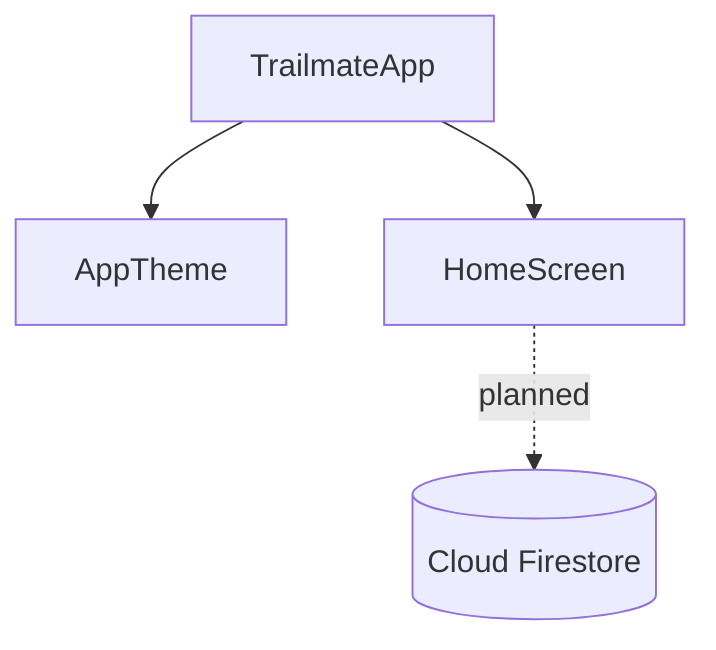

# Architecture {#ch-architecture}

## Overview

Trailmate is a single Flutter app (Dart 3.4+) that targets iOS and Android. Its dependencies
point to Firebase as the backend (`firebase_core`, `cloud_firestore` in `pubspec.yaml`). The
code doesn't initialise Firebase yet ⟨assumption⟩ that this is planned.

## Components

| Component | Responsibility | Location |
|---|---|---|
| `TrailmateApp` | App root, light and dark themes | `lib/main.dart` |
| `AppTheme` / `AppColors` | Material 3 colour scheme, Nunito font | `lib/theme/app_theme.dart` |
| `HomeScreen` | Trail list and **New trail** action | `lib/screens/home_screen.dart` |

## Decision log

### ADR-001: Flutter for both platforms

- **Status:** Accepted
- **Context:** One team ships iOS and Android ⟨assumption⟩.
- **Decision:** Flutter with Material 3 (`useMaterial3: true`).
- **Consequences:** One codebase. Platform-specific UI needs extra work.

# Assumptions and open questions {#ch-assumptions}

Not included: Developer Guide, API Reference, Data Model, Contributing Guide, Testing Strategy, CI/CD and Deployment, Environment and Configuration Reference, Security Threat Model, Dependency Inventory, Tech Debt Register, Integration Guide (not selected for this sample).

| # | Chapter | Item | Type | Why unverified | Who can confirm |
|---|---|---|---|---|---|
| A1 | Architecture | Firebase will be initialised later | assumption | dependency present, no init call | mobile lead |
